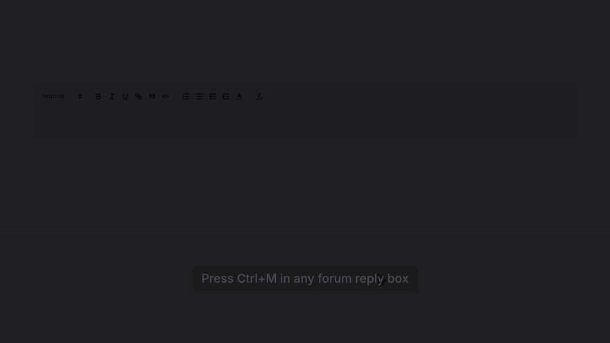
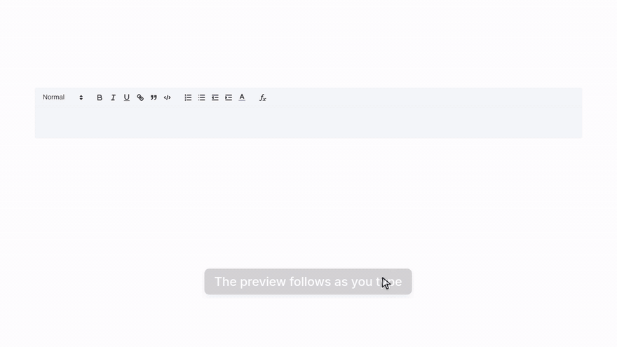
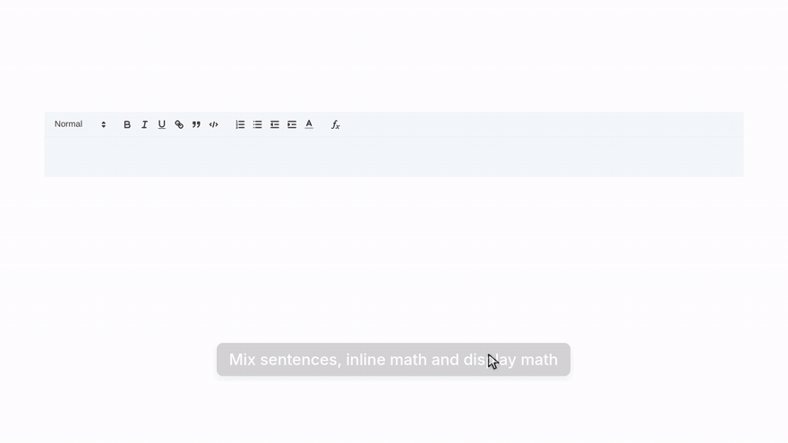
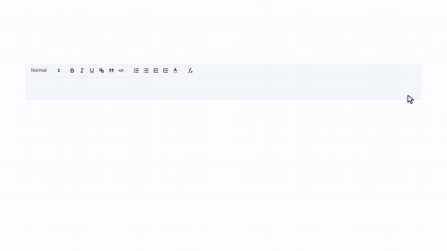
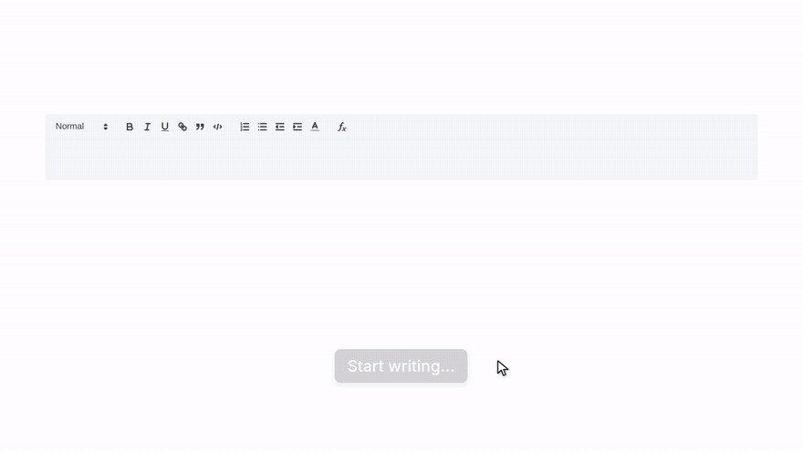

# Natex

If you're regularly typing equations in an external platform and ending up with clunky plain text, this extension is for you!

Natex lets you write LaTeX in Quill-based text editors with a live preview. Type your math, see it render as you go, and insert it straight into the editor. It was built with Minerva University's classroom and forum editors in mind, but works with any Quill editor.

[Watch the full demo (MP4)](assets/demo/natex-demo.mp4) · [30-second version](assets/demo/natex-reel.mp4)

## Key features
* Open the Natex panel from the **fx** button in the editor toolbar or with a hotkey (`Ctrl+M` by default)
* Live KaTeX preview as you type, so you see mistakes before you insert
* Mix text and math (`$…$`) and insert it all at once with `Ctrl+Enter` (one undo step)
* Click a formula already in the editor to open it in the panel and edit it
* Drafts are saved automatically, so you don't lose your work if the page reloads
* Change the hotkey in the extension settings

## See it in action

**Live preview, and mistakes caught before you insert**

**Text, inline math and display math in one go**

**Click a formula to fix it**

**Drafts survive closing the panel and reloading the page**

## How to install

1. Open the [latest release](https://github.com/NWelde/Natex/releases/latest) and download **`natex-<version>.zip`** under Assets (the automatically generated "Source code" downloads require building).
2. Unzip it into a folder you will keep on your computer.
3. Open `chrome://extensions`, enable **Developer mode**, and click **Load unpacked**.
4. Select the extracted folder containing `manifest.json`.
5. Pin Natex from Chrome's extensions menu.

No Node.js, npm, or build commands are needed. Keep the extracted folder: Chrome loads the extension from it.

## Developing

Clone the repo, then run `npm ci && npm run build` with Node.js 22+. Load the repo folder in `chrome://extensions` using **Load unpacked**.

* `npm test`: unit tests for the parsing, rendering and insert logic (`src/core/`).
* `npm run watch`: rebuilds `dist/` on every change; reload the extension in `chrome://extensions` afterwards.
* `tests/e2e/quill.html`: a plain Quill page that loads the built scripts without installing the extension. Serve the repo root (`python3 -m http.server 5174`) and open `http://127.0.0.1:5174/tests/e2e/quill.html`.
* `npm run demo`: re-records the demo videos above in a real browser. See [demo-video/README.md](demo-video/README.md).

Contributions are welcome: see [CONTRIBUTING.md](CONTRIBUTING.md).

Code layout:

* `src/core/`: pure logic (parse `$…$`, render with KaTeX, build Quill inserts). No DOM, unit-tested.
* `src/content/`: the panel UI, injected into pages in a Shadow DOM.
* `src/page/`: a small bridge that runs in the page itself so it can reach the site's Quill editor.

### Creating a release

Run `npm run package` (requires Python 3) to build `release/natex-<version>.zip`. The ZIP contains the extension's runtime files, bundled scripts, and KaTeX fonts.

To publish, keep the versions in `package.json` (and its lockfile) and `manifest.json` aligned, commit the changes, then push a matching version tag, for example `git tag v1.0.0` followed by `git push origin v1.0.0`. GitHub Actions runs the tests, builds the ZIP, and attaches it to a GitHub Release. The **Package extension** workflow can also be run manually to download a build from its workflow artifacts without publishing a release.

## Privacy and data:
* Natex runs only on sites you allow (Quill-based editors).
* It does not send any content to external servers, so LaTeX is processed directly in the page where you are editing.
* Drafts and settings are stored locally in your browser.
* No analytics or tracking are included in this extension.

Full details are in the [privacy policy](PRIVACY.md).

## Credits
Natex is built on top of [ForTex](https://github.com/marilevay/fortex), created by [Marina Levay](https://github.com/marilevay). Thank you for the original extension and the idea behind it!

**Disclaimer**: Natex is an independent project and is not affiliated with or endorsed by Minerva University, Quill, or any learning platform providers.

This project is licensed under the MIT License. See the LICENSE file for details.
